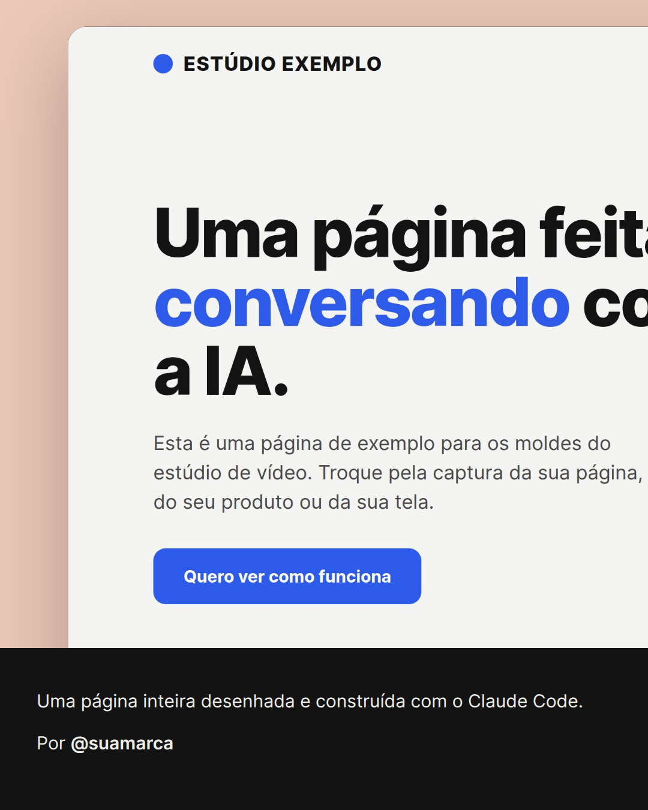
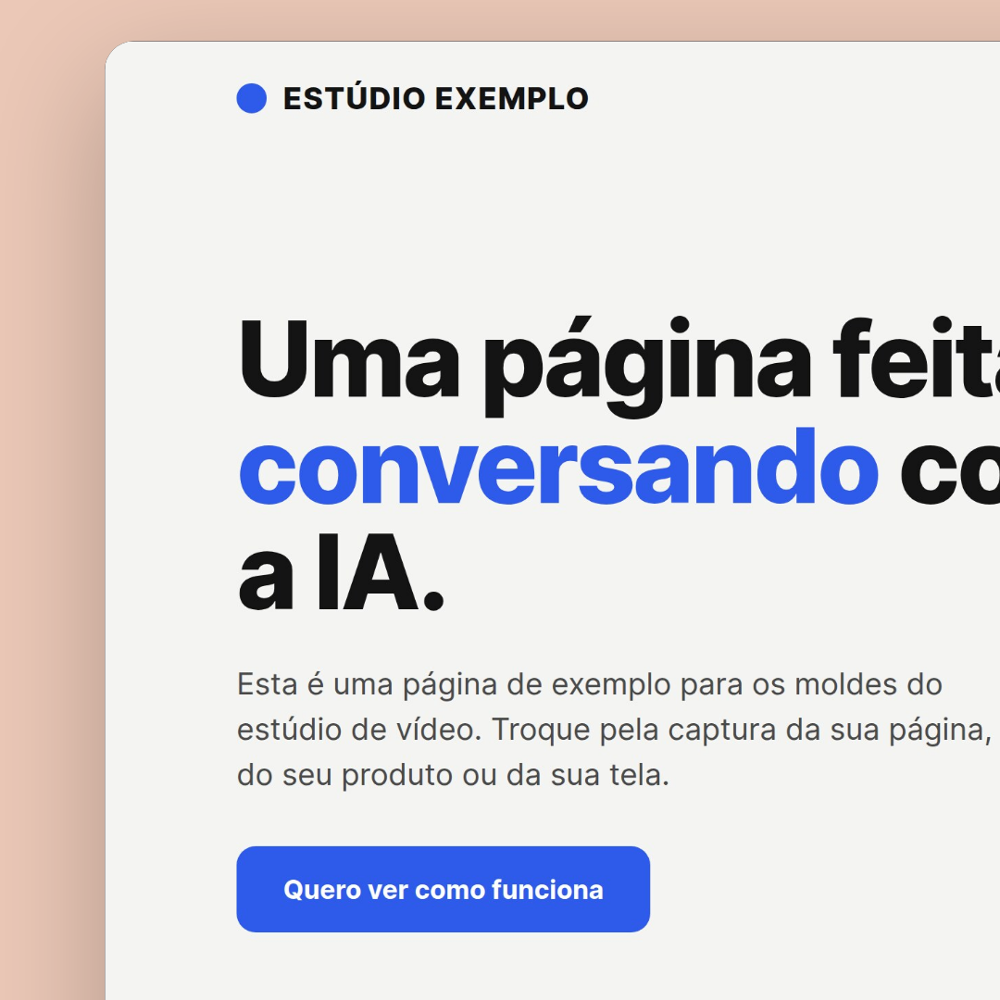
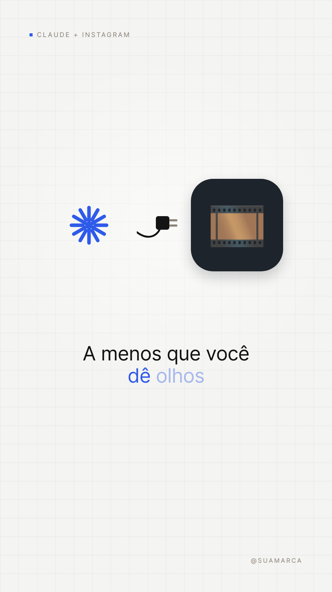
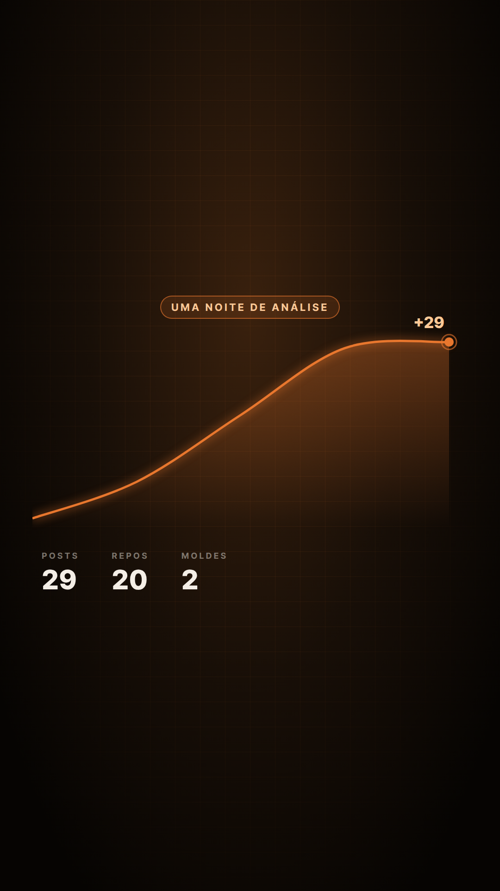
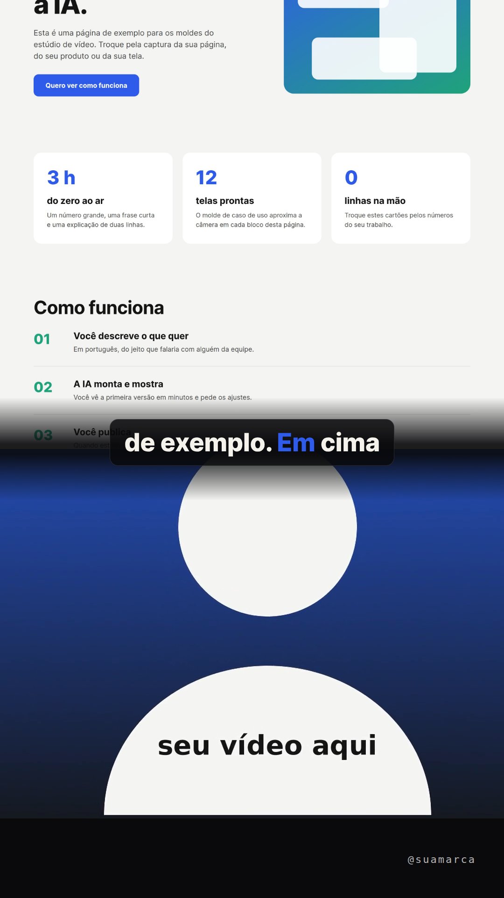
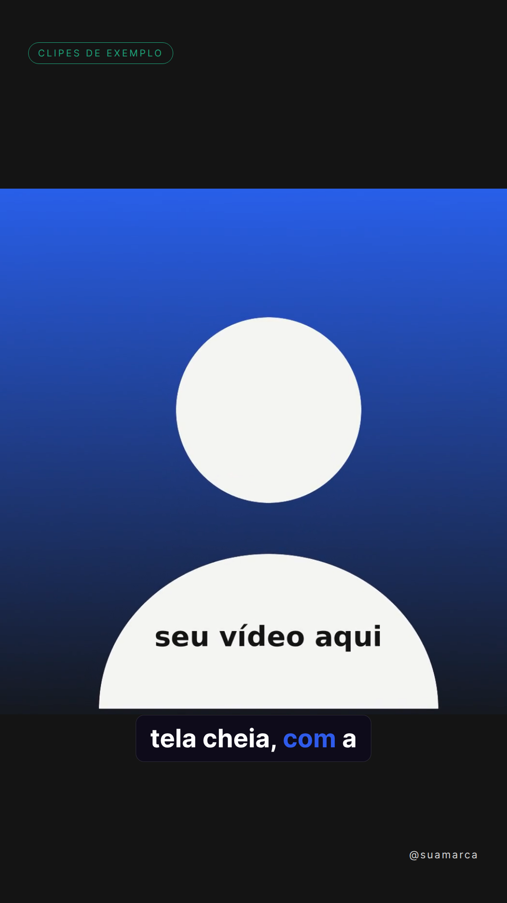
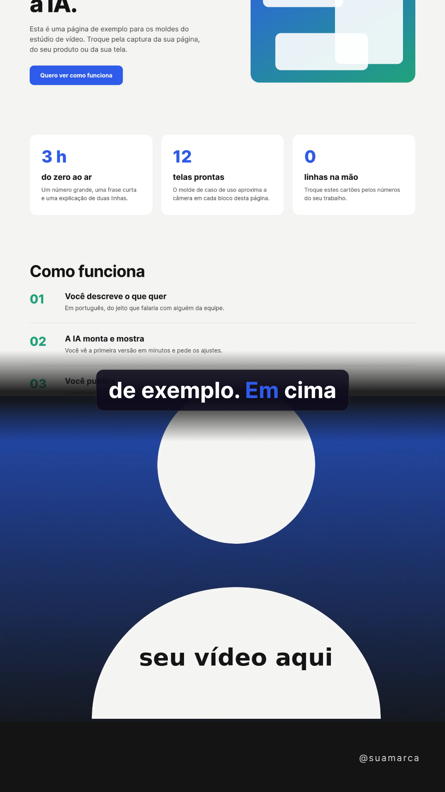
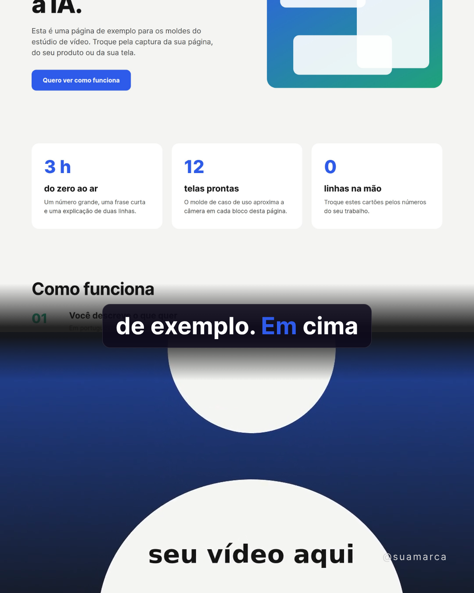
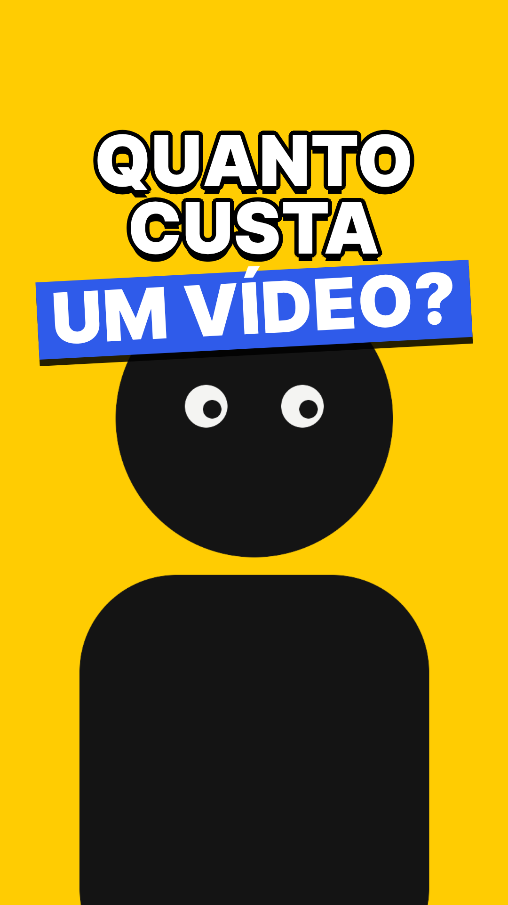
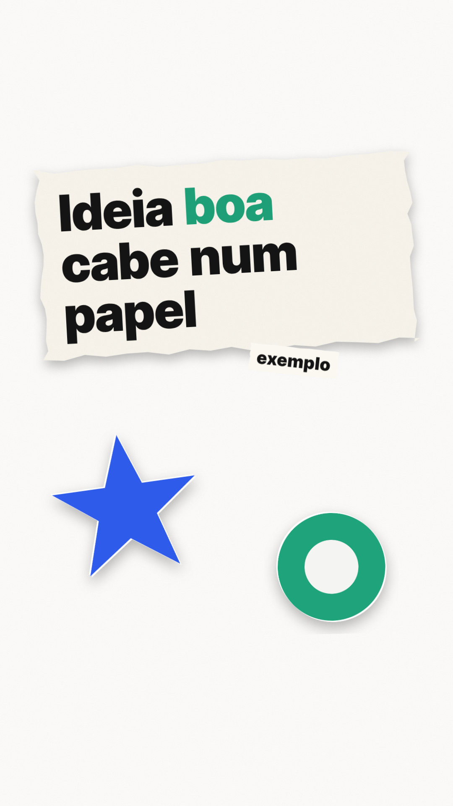

# Galeria de estilos

Cada molde abaixo é um estilo de vídeo pronto, em Remotion (vídeo feito com código React). As capturas estão no tema neutro do estúdio, com mídia de exemplo: azul onde vai a cor principal da sua marca, verde onde vai a secundária, um boneco onde vai o seu rosto. Para pintar com a sua marca, troque as cores em `estudio/src/tema.ts`.

Escolha o estilo olhando. Depois peça ao Claude, por exemplo: *"quero um vídeo no estilo SplitScreen com a minha tela e o meu vídeo"*. A skill `video:estilos` conduz o resto.

Os comandos rodam de dentro da pasta do estúdio, depois do `npm ci`. O vídeo sai em `out/`.

---

## Caso de uso · `CaseCard-4x5` e `CaseCard-1x1`

 

**Medidas:** 1080×1350 (Instagram, com faixa de legenda embaixo) e 1080×1080 (LinkedIn e X, sem a faixa).
**Para que serve:** mostrar uma página, um produto ou uma gravação de tela numa janela flutuante, com uma câmera que aproxima e passeia sem corte seco e um anel marcando o clique.
**Referência:** os vídeos de caso de uso da @claudeai.

```bash
npx remotion render src/index.ts CaseCard-4x5 out/case-4x5.mp4
npx remotion render src/index.ts CaseCard-1x1 out/case-1x1.mp4
```

## Explicador · `Explainer-9x16`



**Medida:** 1080×1920 (Reels, Shorts, TikTok).
**Para que serve:** explicar uma ideia em cenas curtas (terminal, par de ícones, fluxo), com uma ilustração no centro e a legenda entrando palavra por palavra.
**Referência:** os reels explicadores do @thaleslaray.

```bash
npx remotion render src/index.ts Explainer-9x16 out/explicador.mp4
```

## Interface falsa · `FakeUI-9x16`



**Medida:** 1080×1920.
**Para que serve:** contar um resultado com números que sobem, um gráfico que se desenha e um app falso sendo usado. A captura mostra a variante `tudor`, a da referência; a variante `marca` usa o seu tema (`skin: "marca"`).
**Referência:** os tutoriais do @tudormorari.ai.

```bash
npx remotion render src/index.ts FakeUI-9x16 out/interface.mp4
```

## Tela dividida · `SplitScreen-9x16`



**Medida:** 1080×1920.
**Para que serve:** a tela (página, código, planilha) em cima e você falando embaixo, com a legenda na costura. É o formato de quem ensina mostrando.
**Referência:** @leobeckerdesign e @obrunookamoto.

```bash
npx remotion render src/index.ts SplitScreen-9x16 out/tela-dividida.mp4
```

## Clipes em tela cheia · `Animacao-9x16`



**Medida:** 1080×1920.
**Para que serve:** emendar vários clipes seus em tela cheia, com fusão curta entre eles, a sua voz por baixo e a legenda palavra por palavra.

```bash
npx remotion render src/index.ts Animacao-9x16 out/clipes.mp4
```

## Reel em blocos · `ReelMisto-9x16` e `ReelMisto-4x5`

 

**Medidas:** 1080×1920 (Reels) e 1080×1350 (carrossel do Instagram, que corta o que passa de 4:5).
**Para que serve:** montar um vídeo com blocos de estilos diferentes (tela dividida, explicador, interface falsa, clipes, texto atrás da pessoa), com abertura e fechamento opcionais. O mesmo roteiro sai como um reel só ou como um slide por bloco. O nome da marca na abertura e no fechamento fica em `src/Vinhetas.tsx` (`NOME_DA_MARCA`).
**Bloco "texto atrás":** a palavra-chave grande entre o fundo e a pessoa (referência @nekt.ai). Ele precisa de um segundo vídeo só com a pessoa recortada, com fundo transparente, por isso não tem captura aqui.

```bash
npx remotion render src/index.ts ReelMisto-9x16 out/reel.mp4
npx remotion render src/index.ts ReelMisto-4x5 out/reel-4x5.mp4
```

## Capa · `Capa-9x16`



**Medida:** 1080×1920, com o letreiro e o rosto dentro do miolo 3:4 que a grade do perfil mostra.
**Para que serve:** a capa do reel e o primeiro quadro do vídeo. Uma ilustração ou foto sua embaixo e um letreiro grande, com uma linha em tarja inclinada. Não segue o tema: o trabalho dela é parar o dedo no feed.

```bash
npx remotion still src/index.ts Capa-9x16 out/capa.png
```

## Colagem de papel · `Papercraft-9x16`



**Medida:** 1080×1920.
**Para que serve:** cada cena vira uma colagem: papéis coloridos entram pelas bordas, o título aparece numa etiqueta de papel rasgado (cada palavra entra quando é dita) e os recortes sobem como adesivo. Tudo balança em passo de stop motion.

```bash
npx remotion render src/index.ts Papercraft-9x16 out/colagem.mp4
```

---

As capturas são refeitas com `bash testes/galeria.sh` (na raiz do repositório) sempre que um molde mudar.
